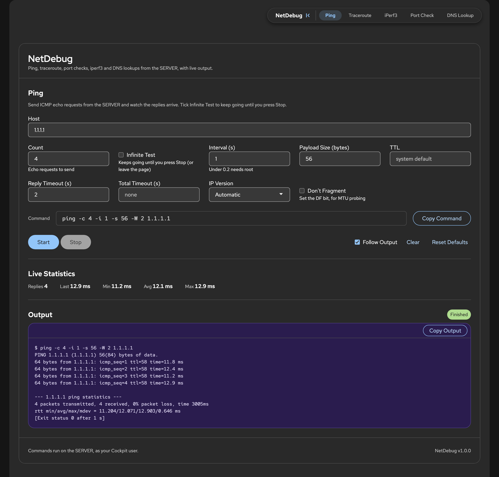
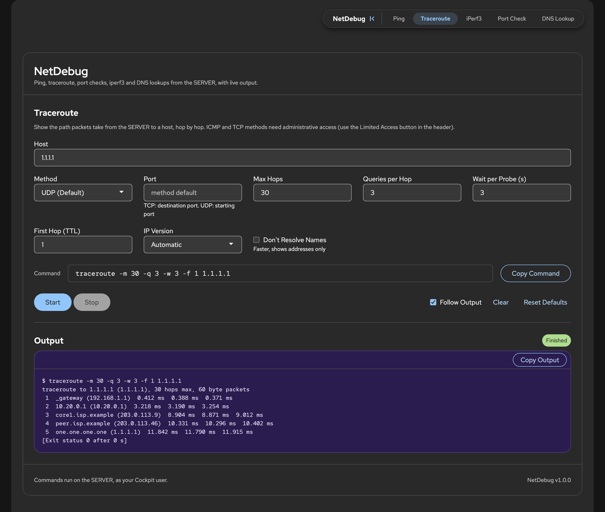
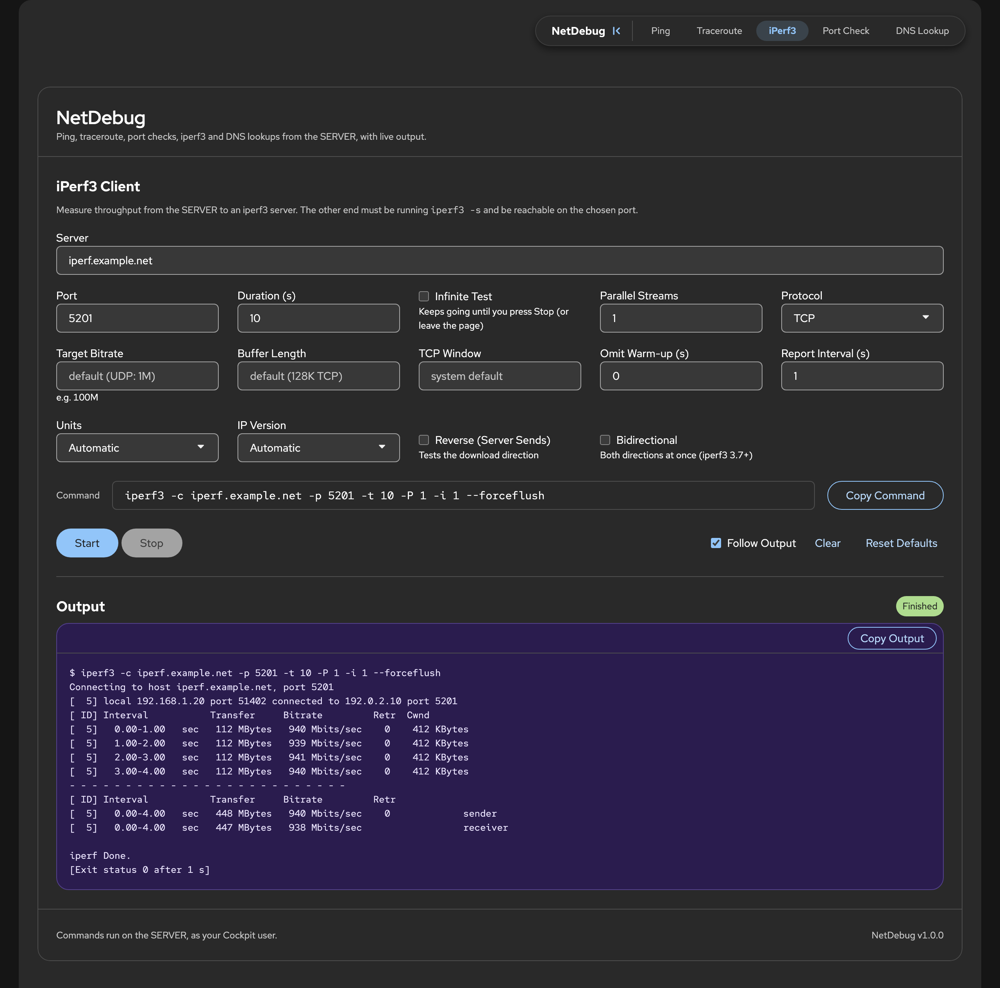
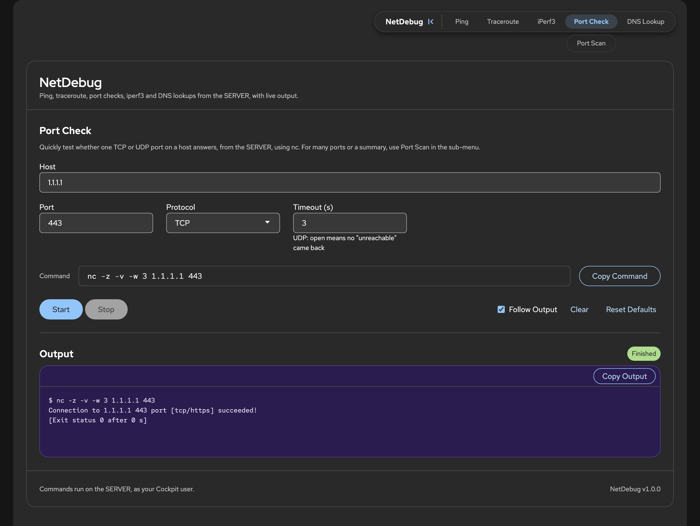
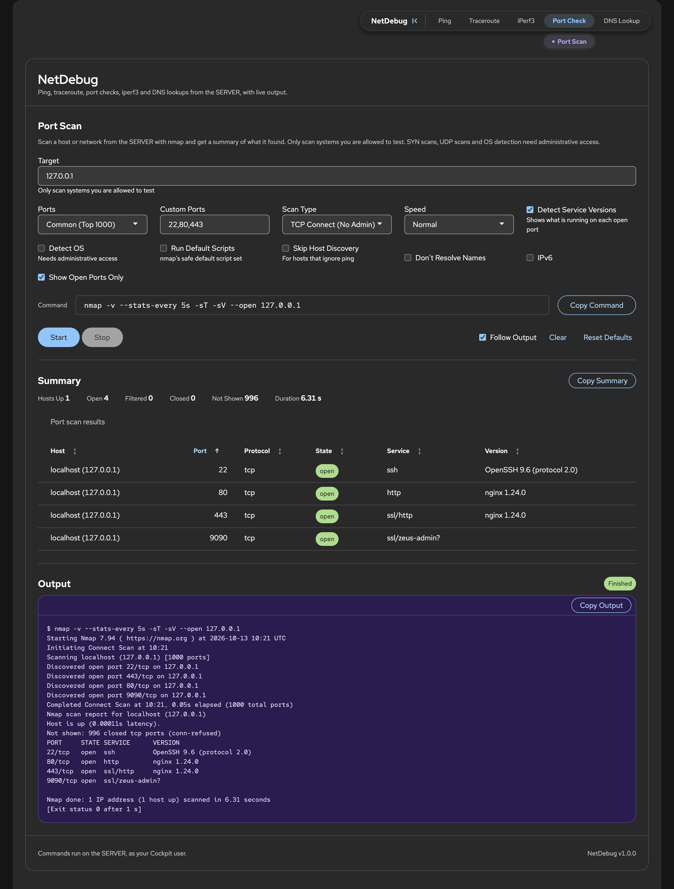
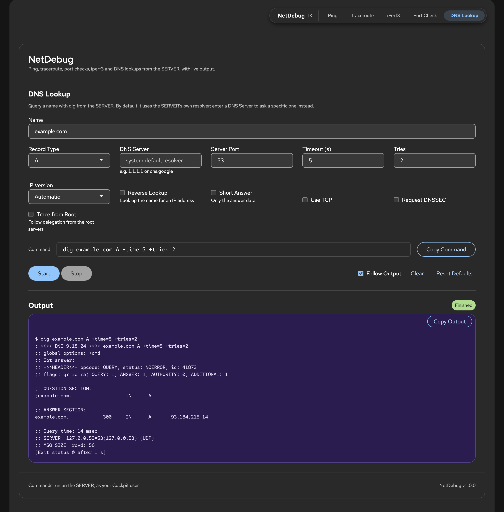

# cockpit-netdebug

[Cockpit](https://cockpit-project.org/) tool page for network debugging from the web interface: ping, traceroute, iperf3, port check and scan, and DNS lookup, each with live output and the common parameters one click away.

Requires no build step: just static HTML/CSS/JS dropped into a Cockpit package directory. Built from [Crewdriver](https://github.com/Crewpit/crewdriver) and installable with [Crewmate](https://github.com/Crewpit/crewmate).

## What it does

Every tool streams its output live, shows the exact command it runs (with **Copy Command**), has **Stop**, **Copy Output**, **Clear** and **Reset Defaults**, and remembers its last values and your recent hosts in this browser only. Running tests are stopped when you leave the page.

### Ping

Count or infinite test, interval, payload size, TTL, timeouts, IPv4/IPv6, Don't Fragment. Live reply count, last, min, avg and max.



### Traceroute

UDP, ICMP or TCP method, port, max hops, queries per hop, wait per probe, first hop, skip name resolution.



### iPerf3

Client test against your own `iperf3 -s`: duration or infinite, parallel streams, TCP/UDP, bitrate, window, reverse, bidirectional, units.



### Port Check (`nc`)

Test one TCP or UDP port.



### Port Scan (`nmap`, under Port Check)

Host or CIDR range (up to a /16), common/fast/custom/all ports, TCP connect, SYN or UDP scan, service and OS detection. A summary and a sortable results table fill in while it runs.



### DNS Lookup (`dig`)

Any common record type, reverse lookup, custom DNS server, short answer, trace from root, DNSSEC, TCP.



*Screenshots show sample output.*

## Layout

- `manifest.json` - package metadata, tells the Cockpit shell about this tool
- `preflight.json` - the commands it needs (`ping`, `traceroute`, `iperf3`, `dig`, `nc`, `nmap`) and the packages that provide them
- `index.html` - page markup (one pane per tool)
- `index.js` - the tools: one config per tool (fields, argument builder, output parser) and the shared runner
- `functions.js` - reusable features exposed as `window.App` (menu, alerts, sortable table, clipboard, polling...)
- `theme.js` - keeps the dark/light theme in sync with the shell
- `index.css`, `cockpit-glue.css` - page styles and the layout glue every embedded Cockpit page needs
- `vendor/patternfly/` - vendored PatternFly CSS

## Installing

The target machine needs Cockpit 175 or newer and the commands listed in `preflight.json`: `ping`, `traceroute`, `iperf3`, `dig`, `nc` and `nmap`.

### Recommended: Crewmate

Try [Crewmate](https://github.com/Crewpit/crewmate) first. It is the recommended package manager for Crewpit apps and can install **cockpit-netdebug** straight from this repository, [Crewpit/cockpit-netdebug](https://github.com/Crewpit/cockpit-netdebug).

### Manual

Get the code, then copy it into `/usr/share/cockpit/cockpit-netdebug` on the machine you want to debug from:

```bash
git clone https://github.com/Crewpit/cockpit-netdebug.git
cd cockpit-netdebug
```

With `rsync` (needs `rsync` on both ends):

```bash
rsync -rvh --exclude .git --exclude screenshots ./ root@<host>:/usr/share/cockpit/cockpit-netdebug/
```

Or with `scp`:

```bash
scp -r . root@<host>:/usr/share/cockpit/cockpit-netdebug
```

If you are already on the target machine, `cp -r . /usr/share/cockpit/cockpit-netdebug` as root does the same.

Reload Cockpit in the browser and **NetDebug** shows up in the sidebar under Tools. Cockpit lists a package's files when you log in, so after adding a new file (not just editing one), log out and back in or it will 404.

To update, pull the latest changes and copy them over again.


## Safety

Commands are started from an argument list, never through a shell. The host must look like a host name or IP address and can't start with `-`, so it can't be taken for an option.
